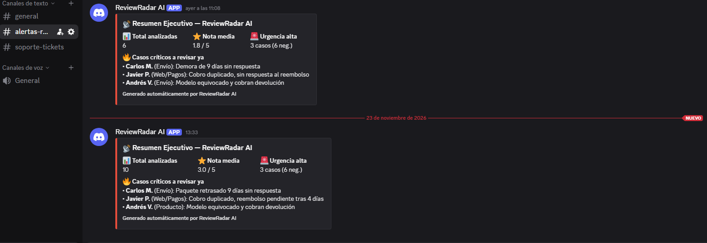

# 📡 ReviewRadar AI — Análisis de Reseñas y Alertas de Operaciones

Aplicación web y pipeline automatizado en Python para analizar reseñas de clientes con IA, detectar incidencias críticas al instante, redactar respuestas listas para enviar y notificar al equipo mediante Webhooks.

## 🎬 Demo


https://github.com/user-attachments/assets/46ad8231-c8e4-4bfc-b09f-14d119c099ff



[Guion y texto de portfolio](DEMO.md)

## 🎯 Problema, Solución e Impacto

* **Problema:** Los equipos de atención al cliente y operaciones pierden horas leyendo reseñas dispersas, clasificando quejas manualmente y redactando respuestas repetitivas, con el riesgo de detectar tarde casos graves (cobros duplicados, envíos perdidos o reclamaciones).
* **Solución:** Una herramienta interactiva en **Python + Streamlit** que procesa archivos CSV de reseñas usando la API de **Groq** con salida estructurada en JSON, clasifica sentimiento, categoría y urgencia, genera borradores de respuesta empáticos y envía un resumen ejecutivo a **Discord** vía Webhook (fácilmente adaptable a Slack o Microsoft Teams).
* **Impacto:** Reduce el triaje y respuesta de un lote de reseñas de varios minutos de trabajo manual a segundos, priorizando automáticamente los casos de urgencia alta y permitiendo exportar informes filtrados para Excel.

## ✨ Funcionalidades principales

* **Análisis estructurado con IA (JSON):** Extrae sentimiento (`Positivo`, `Neutro`, `Negativo`), categoría operativa, nivel de urgencia, resumen ejecutivo y respuesta sugerida.
* **Panel interactivo tipo SaaS:** KPIs en tiempo real, gráficos dinámicos con Plotly y filtros combinados por sentimiento, urgencia y categoría.
* **Priorización automática:** Las incidencias de urgencia alta aparecen desplegadas primero con respuestas listas para copiar en un clic.
* **Alertas por Webhook:** Envío de resumen ejecutivo con tarjeta estructurada (*Embed*) al canal de operaciones.
* **Exportación a Excel:** Descarga del informe filtrado en formato CSV con codificación `utf-8-sig`.

## 🛠️ Stack tecnológico

* **Lenguaje:** Python 3
* **Interfaz y visualización:** Streamlit, Plotly, Pandas
* **IA (LLM):** Groq API (`openai/gpt-oss-120b`) con `response_format: json_object`
* **Automatización y alertas:** Webhooks (Discord) vía `requests`
* **Seguridad y configuración:** Variables de entorno con `python-dotenv`

## 📂 Estructura del proyecto

```text
review-radar/
├── data/
│   ├── resenas_ejemplo.csv      # Dataset de prueba
│   └── resenas_analizadas.csv   # Caché de resultados procesados
├── src/
│   ├── analyzer.py              # Conexión con Groq y salida JSON estructurada
│   ├── processor.py             # Procesamiento por lotes con pandas
│   └── alerts.py                # Envío de resumen ejecutivo vía Webhook
├── app.py                       # Aplicación web en Streamlit
├── .env.example                 # Plantilla de variables de entorno
└── requirements.txt             # Dependencias del proyecto

## 🧪 Tests

Los tests no llaman a Groq ni a Discord (usan respuestas simuladas):

```bash
pip install -r requirements-dev.txt
python -m pytest
```

## ⚠️ Uso responsable y privacidad

* Las reseñas son texto de terceros. La IA puede equivocarse o dejarse llevar por instrucciones escondidas en una reseña, así que **una persona debe revisar cada respuesta sugerida antes de enviarla**.
* Los comentarios y los nombres de cliente se envían a Groq para analizarlos y, en el resumen, a Discord. Con datos reales de clientes eso entra en la RGPD: informa a tus clientes y revisa las condiciones de ambos servicios.
* Los datos de `data/` son **ficticios**, creados para la demo.

## 🤝 Cómo se ha hecho

Desarrollado con ayuda de Claude (Anthropic) y Gemini (Google). Yo definí la idea y los requisitos, y decido qué se incorpora al proyecto; los tests y el CI comprueban el resto.

## 📄 Licencia

MIT. Consulta [LICENSE](LICENSE).
